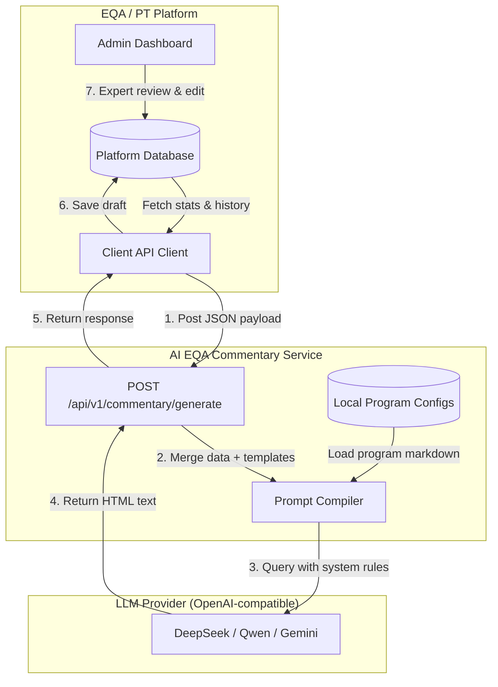
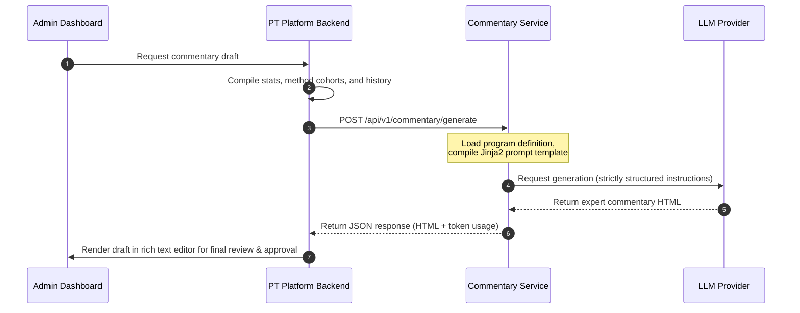

# AI EQA Commentary Generator

An open-source microservice built with FastAPI and any OpenAI-compatible LLM API (DeepSeek, Qwen, Gemini, ...) to automatically generate expert clinical commentaries for laboratory proficiency testing (PT) and External Quality Assessment (EQA) schemes. 

This service helps PT/EQA providers automate draft commentary reports by combining raw laboratory data, method performance cohorts, historical results, and clinical rules.

---

## System Architecture

The service is completely stateless and designed around a **Push-Only** model. Any EQA/PT management system can compile results and history, send a payload to this service, and receive a beautifully formatted clinical expert commentary draft in HTML.



### Data Flow Sequence



---

## Directory Structure

```text
expert-commentary-service/
├── app/
│   ├── __init__.py
│   ├── main.py        # FastAPI app & endpoint routing
│   ├── schemas.py     # Pydantic models for EQA data validation
│   ├── services.py    # Prompt orchestration & LLM API interaction
│   └── prompts.py     # System instructions and clinical quality guardrails
├── config/
│   └── programs/      # Default Markdown guidelines for specific EQA programs
│       └── malaria-diagnostic.md
├── tests/
│   └── test_api.py    # Pytest suite
├── pyproject.toml     # UV dependency file
├── LICENSE            # MIT License
└── Dockerfile         # Lightweight multi-stage Docker configuration
```

---

## Customizing EQA Program Contexts

You can specify the clinical rules, educational materials, and general description of an EQA program in two ways:

1. **Dynamically**: Pass a `program_description` string inside the POST request payload.
2. **Statically**: Create a Markdown file in `config/programs/` named `{program_code}.md` (e.g. `MALARIA-RDT.md`). The service will automatically load this template if no `program_description` is supplied in the request.

---

## Development Setup

### System Prerequisites
- [UV](https://github.com/astral-sh/uv) (Python package and workflow manager)
- [Docker](https://docs.docker.com/) (Optional, for containerized deployments)

### Local Environment Setup

1. **Install Dependencies**
   Install the virtual environment and all packages:
   ```bash
   uv sync
   ```

2. **Configure Environment**
   Create a `.env` file in the root directory:
   ```env
   LLM_BASE_URL=https://api.deepseek.com
   LLM_MODEL=deepseek-flash
   LLM_API_KEY=your_provider_api_key_here
   # Optional, seconds to wait for the provider
   # LLM_TIMEOUT=110
   PORT=8005
   # Optional: when set, requests must send a matching X-Service-Token header
   SERVICE_TOKEN=shared_secret_with_the_calling_backend
   ```

3. **Run the Application**
   Start the FastAPI development server:
   ```bash
   uv run fastapi dev app/main.py --port 8005
   ```
   Once running, access the interactive OpenAPI documentation at [http://localhost:8005/docs](http://localhost:8005/docs).

---

### Docker Image

Every push to `main` publishes `ghcr.io/tony-nyagah/expert-commentary-service` tagged `latest`, `main` and `sha-<short sha>`; version tags like `v1.2.3` also publish `1.2.3` and `1.2`. Pin a `sha-` or version tag in deployments.

```bash
docker run -p 8005:8005 \
  -e LLM_BASE_URL=https://api.deepseek.com -e LLM_MODEL=deepseek-flash -e LLM_API_KEY=sk-... \
  -e SERVICE_TOKEN=shared_secret \
  ghcr.io/tony-nyagah/expert-commentary-service:latest
```

### LLM Providers

The service calls the provider's OpenAI-compatible chat completions API, so any provider that offers one works and switching is only a matter of `LLM_BASE_URL`, `LLM_MODEL` and `LLM_API_KEY`:

| Provider | `LLM_BASE_URL` | Example `LLM_MODEL` |
|---|---|---|
| DeepSeek | `https://api.deepseek.com` | `deepseek-flash`, `deepseek-v4-pro` |
| Qwen (DashScope) | `https://{WorkspaceId}.ap-southeast-1.maas.aliyuncs.com/compatible-mode/v1` | `qwen3.8-max` |
| Gemini | `https://generativelanguage.googleapis.com/v1beta/openai/` | `gemini-3.8-flash` |

Model names change often; check the provider's docs. Without `LLM_API_KEY` the service returns a placeholder commentary, which is handy for development. `GET /health` shows the base URL and model in use.

---

## Key Integration Point

### Endpoint: `POST /api/v1/commentary/generate`

**Request Schema:**

Send an `X-Service-Token` header when `SERVICE_TOKEN` is configured. `example_commentaries` are earlier commentaries for the same program written by people; the model copies their structure and tone but must not reuse their figures. `warning`, `ungraded`, `review_comment`, `assigned_value`, cohort `mean`/`cv`, and all the lists except `analytes` are optional.

```json
{
  "program_code": "MALARIA-RDT",
  "program_name": "Malaria Rapid Diagnostic Tests EQA",
  "event_name": "TE-2026-02",
  "overall_pass_rate": 92.0,
  "analytes": [
    {
      "name": "Malaria Antigen",
      "is_quantitative": false,
      "review_comment": "Several false negatives on Sample C",
      "samples": [
        {
          "name": "Sample A",
          "assigned_value": "Positive",
          "participants": 40,
          "acceptable": 36,
          "warning": 0,
          "not_acceptable": 4,
          "ungraded": 0,
          "pass_rate": 90.0
        }
      ]
    }
  ],
  "cohorts": [
    {
      "name": "SD BIOLINE",
      "kind": "reagent",
      "participant_count": 30,
      "acceptable_percent": 93.33
    }
  ],
  "common_failure_modes": [
    "Incubation time overrun",
    "Incorrect buffer volume"
  ],
  "history": [
    {
      "event_name": "TE-2026-01",
      "pass_rate": 87.5
    }
  ],
  "example_commentaries": [
    "<p>This EQA program tests the ability to detect malaria parasites...</p>"
  ]
}
```

**Response Schema:**
```json
{
  "commentary_html": "<p>This EQA cycle evaluated...</p>",
  "usage_tokens": 1280
}
```

---

## License

This project is licensed under the MIT License. See [LICENSE](LICENSE) for details.
