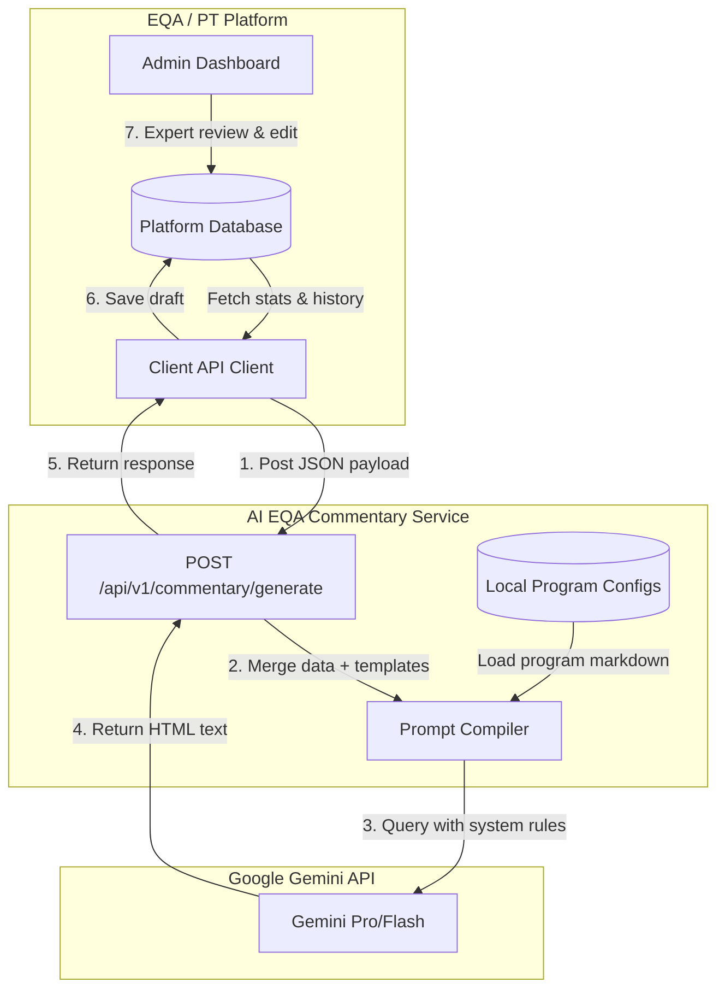
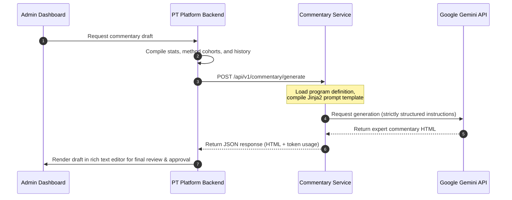

# AI EQA Commentary Generator

An open-source microservice built with FastAPI and Google Gemini API to automatically generate expert clinical commentaries for laboratory proficiency testing (PT) and External Quality Assessment (EQA) schemes. 

This service helps PT/EQA providers automate draft commentary reports by combining raw laboratory data, method performance cohorts, historical results, and clinical rules.

---

## System Architecture

The service is completely stateless and designed around a **Push-Only** model. Any EQA/PT management system can compile results and history, send a payload to this service, and receive a beautifully formatted clinical expert commentary draft in HTML.



### Data Flow Sequence



---

## Directory Structure

```text
expert-commentary-service/
├── app/
│   ├── __init__.py
│   ├── main.py        # FastAPI app & endpoint routing
│   ├── schemas.py     # Pydantic models for EQA data validation
│   ├── services.py    # Prompt orchestration & LLM API interaction
│   └── prompts.py     # System instructions and clinical quality guardrails
├── config/
│   └── programs/      # Default Markdown guidelines for specific EQA programs
│       └── malaria-diagnostic.md
├── tests/
│   └── test_api.py    # Pytest suite
├── pyproject.toml     # UV dependency file
├── LICENSE            # MIT License
└── Dockerfile         # Lightweight multi-stage Docker configuration
```

---

## Customizing EQA Program Contexts

You can specify the clinical rules, educational materials, and general description of an EQA program in two ways:

1. **Dynamically**: Pass a `program_description` string inside the POST request payload.
2. **Statically**: Create a Markdown file in `config/programs/` named `{program_code}.md` (e.g. `MALARIA-RDT.md`). The service will automatically load this template if no `program_description` is supplied in the request.

---

## Development Setup

### System Prerequisites
- [UV](https://github.com/astral-sh/uv) (Python package and workflow manager)
- [Docker](https://docs.docker.com/) (Optional, for containerized deployments)

### Local Environment Setup

1. **Install Dependencies**
   Install the virtual environment and all packages:
   ```bash
   uv sync
   ```

2. **Configure Environment**
   Create a `.env` file in the root directory:
   ```env
   GEMINI_API_KEY=your_gemini_api_key_here
   PORT=8005
   ```

3. **Run the Application**
   Start the FastAPI development server:
   ```bash
   uv run fastapi dev app.main:app --port 8005
   ```
   Once running, access the interactive OpenAPI documentation at [http://localhost:8005/docs](http://localhost:8005/docs).

---

## Key Integration Point

### Endpoint: `POST /api/v1/commentary/generate`

**Request Schema:**
```json
{
  "program_code": "MALARIA-RDT",
  "program_name": "Malaria Rapid Diagnostic Tests EQA",
  "event_name": "TE-2026-02",
  "overall_average_score": 92.5,
  "samples": [
    {
      "sample_name": "Sample A",
      "target_value": null,
      "pass_rate": 90.0,
      "average_score": 90.0
    }
  ],
  "cohorts": [
    {
      "method_name": "Immunochromatography",
      "participant_count": 45,
      "mean": 91.2,
      "cv": 5.4
    }
  ],
  "common_failure_modes": [
    "Incubation time overrun",
    "Incorrect buffer volume"
  ],
  "history": [
    {
      "event_name": "TE-2026-01",
      "average_score": 89.0,
      "pass_rate": 87.5
    }
  ]
}
```

**Response Schema:**
```json
{
  "commentary_html": "<p>This EQA cycle evaluated...</p>",
  "usage_tokens": 1280
}
```

---

## License

This project is licensed under the MIT License. See [LICENSE](LICENSE) for details.
